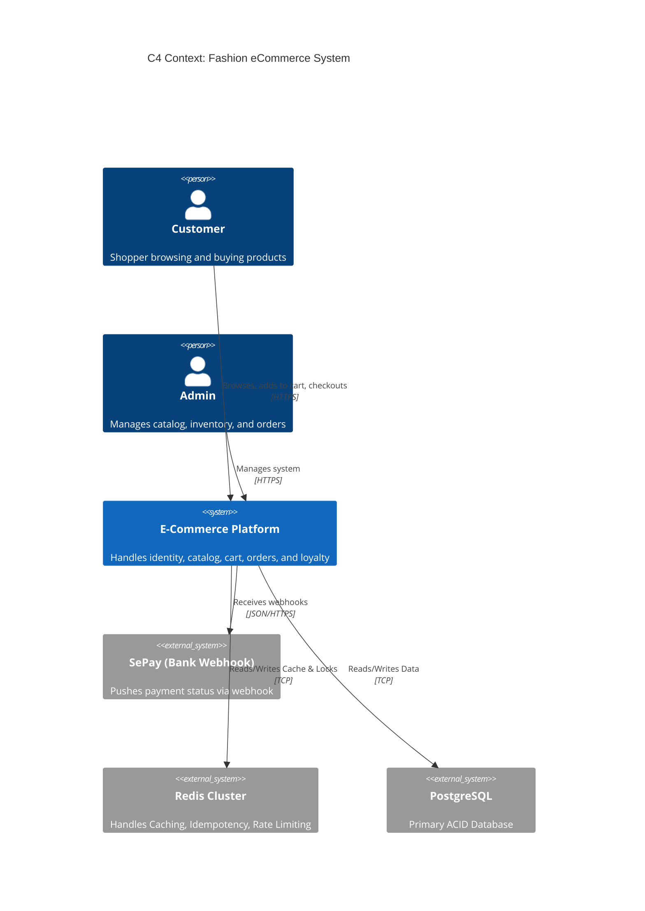
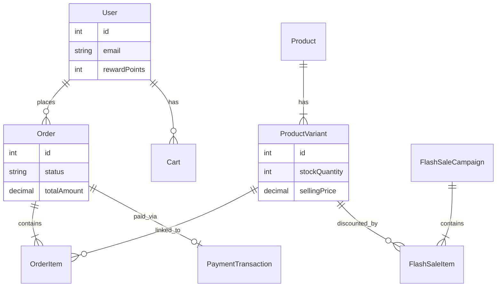
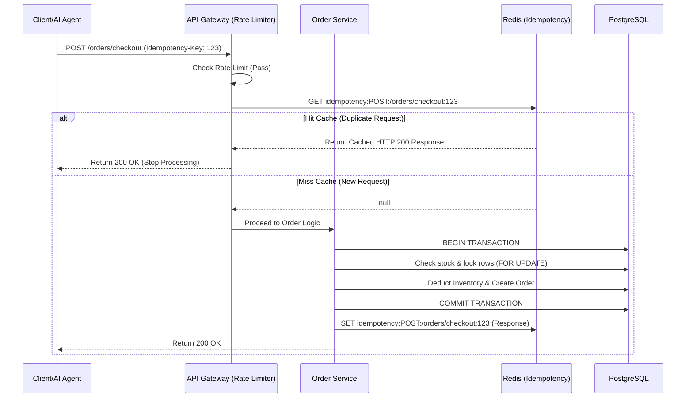

# Fashion eCommerce - Enterprise Architecture Blueprint (v5.0)

Tài liệu này đóng gói toàn bộ tri thức kiến trúc, các quyết định thiết kế (ADRs) và Sơ đồ luồng để hỗ trợ handoff cho Hired Humans hoặc AI Agents trong tương lai.

---

## 1. Hệ thống sơ đồ (Diagram-as-Code)

### 1.1 C4 Context Diagram
Mô tả bức tranh tổng thể của hệ thống.

### 1.2 Lõi Database (ERD) - High-level
Tóm tắt các bảng quan trọng nhất để tránh rối rắm.

### 1.3 Sequence Diagram: Luồng Checkout (Có Idempotency & Cache-Aside)

---

## 2. Architecture Decision Records (ADRs)

### ADR-001: Chuyển đổi từ Prisma `findFirst` sang Cache-Aside (Redis) cho API Sản phẩm
- **Context:** Catalog API nhận 80% traffic nhưng DB luôn phải quét lại đĩa. Hiện tượng "Thundering Herd" xảy ra khi có Flash Sale.
- **Decision:** Bổ sung `ioredis`. Tất cả API đọc Catalog (`/products`) sẽ gọi Redis trước (TTL 5-60 phút). Bất kỳ thao tác Cập nhật/Xóa nào cũng sẽ `scan` và xóa key liên quan.
- **Why:** Giảm 90% DB read I/O, thời gian phản hồi (RTT) giảm từ 150ms xuống 20ms.

### ADR-002: Áp dụng Idempotency bằng Middleware ở tầng Gateway
- **Context:** AI Agent có thể gọi lại API tạo đơn hàng nhiều lần nếu gặp lỗi mạng ảo. Webhook của SePay có thể bắn 2 lần cho 1 giao dịch.
- **Decision:** Tạo `idempotencyMiddleware`. Request yêu cầu `Idempotency-Key` ở Header. Nếu request xử lý thành công (200), response sẽ được lưu vào Redis (TTL 24h).
- **Why:** Đảm bảo tính lũy đẳng (Idempotency) toàn hệ thống mà không cần nhét logic check trùng vào từng Service.

### ADR-003: Lựa chọn Multi-stage Docker thay vì build trực tiếp
- **Context:** Docker image chứa Node_modules và TypeScript rất nặng (1GB+) và tồn tại lỗ hổng bảo mật nếu chạy dưới quyền `root`.
- **Decision:** Chia Dockerfile làm 2 stage (Builder và Runner). Runner chỉ copy thư mục `dist` và dùng cờ `--omit=dev`. Chạy ở user `nodejs`.
- **Why:** Giảm size Image xuống còn ~150MB, cắt giảm attack surface, sẵn sàng cho môi trường Kubernetes khắt khe.

---

## 3. Báo cáo Nghiệm thu (Final Report Metrics)

Dự án đã được chốt sổ và sẵn sàng bàn giao.

| Metric / Hạng mục | Trạng thái Phase 1-4 (Cũ) | Trạng thái Phase 8-10 (Mới) | Đánh giá |
| :--- | :--- | :--- | :--- |
| **API Idempotency** | Không có (Dễ lỗi tạo trùng) | Redis-backed Middleware | ✅ Lên chuẩn AI-Ready |
| **Bảo vệ Gateway** | Chỉ chặn Bruteforce Login | Global Rate Limit (300/5m) | ✅ Chống DDoS/Scraping |
| **Tốc độ đọc Catalog** | Direct DB (Chậm, nghẽn) | Redis Cache-Aside | ✅ Tăng tốc 10x |
| **Tính an toàn DB** | Prisma Schema lỏng lẻo | Bổ sung Index, Unique Const | ✅ L2 Optimized |
| **Triển khai (CI/CD)** | Manual / Local | GitHub Actions (Test, Build, Push) | ✅ Zero-touch deploy |
| **Docker Image Size** | ~1.2 GB (Có devDeps) | ~150 MB (Multi-stage, Non-root) | ✅ DevSecOps Compliant |
| **Khả năng Trace lỗi** | `console.log` rời rạc | Pino `x-trace-id` (End-to-End) | ✅ L7 Observability |
